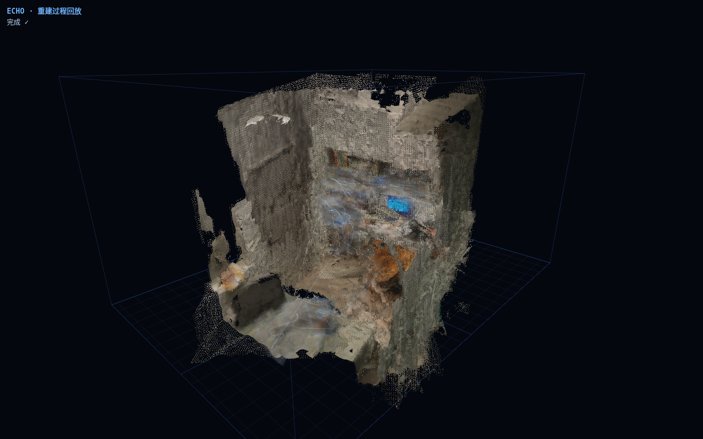
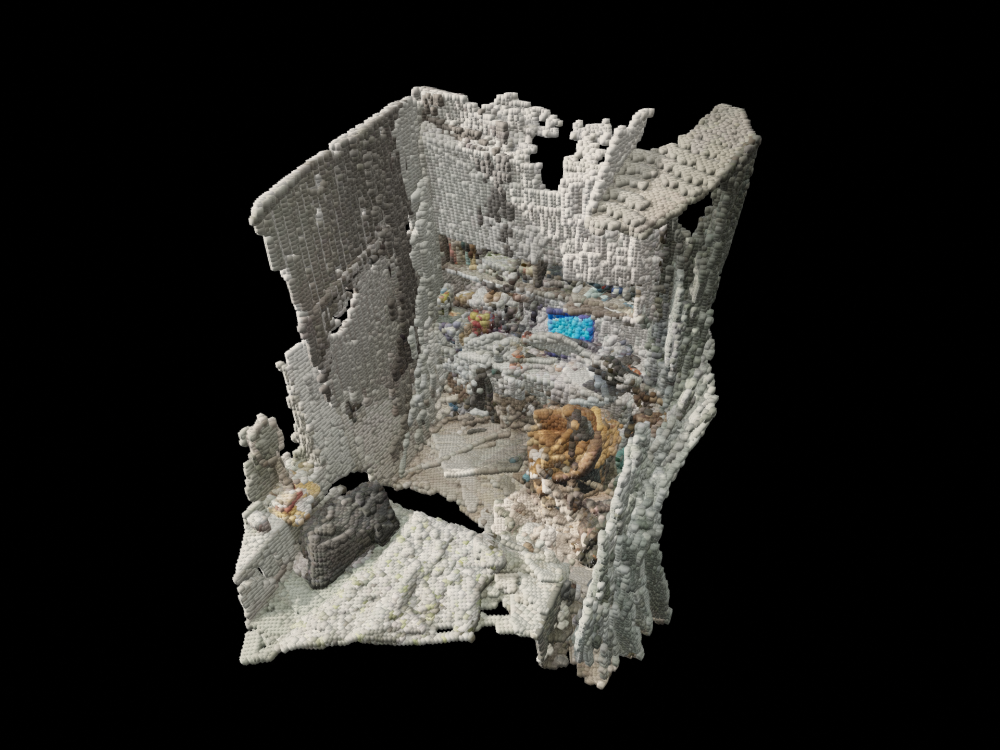
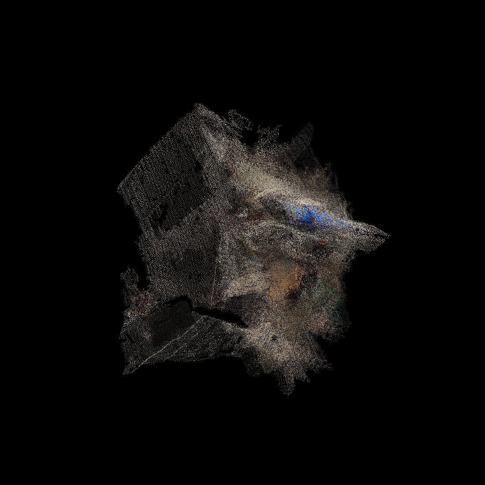

# ECHO 回声

**拖一段慢走视频进来，得到一个能重访的 3D 场景。**

在房间里慢慢走一圈，拍下一段视频，把它拖进 ECHO。等它跑完，你就得到这个房间的 3D 场景——可以随时打开、转着看，像回到现场一样。

## 你会得到什么

- **一个完整的 3D 场景**：一段慢走视频，变成能打开、能旋转查看的 3D 场景。
- **有体积、有颜色的像素实体模型**：场景由一颗颗带颜色的小方块组成，是实心的、有画面的；导出是通用格式（GLB / PLY），可以直接放进 Blender 继续用。
- **深度视频**：一键把普通视频变成黑白的深度画面，近亮远暗，像给空间拍了一张 X 光片。
- **自动摆正、自动清爽**：场景出来自己就是正的；乱飞的杂点会被自动清掉，不用你修。

## 生成的过程，也是一场表演

ECHO 正在把「场景是怎么长出来的」做成 Detroit 风格的蓝线框实况预览：照片一张张浮出来，拍摄路线在蓝色网格里一笔一笔画出来，每张照片贴到它对着的墙上、碎成点，再沉进正在长大的场景里。

## 怎么用（三步）

1. 在下方下载 Windows 版软件，解压，双击打开。
2. 把一段在房间里慢慢走一圈拍的视频拖进去（走慢一点、不要变焦，效果更好）。
3. 等它跑完，场景会自动打开。

## 下载

- 📦 [发布页：所有版本](https://github.com/REDrighthand05/echo4d/releases)
- ⬇️ [直接下载 v0.1.1（Windows 版）](https://github.com/REDrighthand05/echo4d/releases/download/v0.1.1/EchoScene-windows.zip)

## 说句实在话

这是早期版本（当前 v0.1.1），能完整地把视频变成场景，但还在快速变好中。欢迎试用，更欢迎告诉我们哪里不好用。

## 接下来想做的

- **真实大小**：从画面里认得出的东西（比如一个矿泉水瓶）反推尺寸，让场景带上真实比例。
- **路线回放**：沿着你当时走过的路线，带你把这个空间再走一遍。
- **实况预览进软件**：上面那场「表演」直接住进软件窗口，边算边看，不再干等。

---

*ECHO 回声 — 把走过的地方，留下来。*
